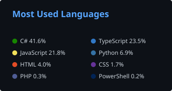

<h1 align="center">Demiralp Öztürk</h1>

  

  
  
  

  
  
  

---

### ⚡ Who I am

I am the **one-person engineering department** of **Aslan Group**, a group of customs, logistics and foreign-trade companies in İstanbul. Every system the business runs on, I designed, built, deployed and maintain myself: the servers, the databases, the backends, the web portals, the desktop tools, the mobile app and the bots that tie them together.

I don't hand off. I take a problem from a conversation in the hallway to a system in production that people depend on every day.

### 🏗️ What I've built and run in production

| | Systems |
|---|---|
| 📈 **CRM & Sales** | Business-development CRM where every call and company meeting is logged, tracked and followed up: call records, meeting notes, target-company pipelines, tags, reminders, calendar, Outlook integration, company & contact finder, PDF reporting. Shared server, used by the whole sales team. |
| 🛡️ **CRM & Audit Platform** | Multi-module NestJS + Next.js platform: customers, appointments, assets, office leases, reporting, e-mail OTP two-factor login, role-based access and full audit trail. |
| 💰 **Finance & Treasury** | Payment-instruction and approval system with four-eyes control, CFO thresholds, loans, guarantees, rent, tax and cash-flow tracking. Every action audited, nothing deleted. |
| 🔗 **Enterprise Integrations** | Customs ERP integrations over MSSQL, scheduled reporting engines that e-mail operations and management automatically, time-attendance (turnstile) system integrations. |
| 📱 **Mobile** | Field check-in app for iOS & Android (Expo) with GPS geofencing, live backend and admin panel with maps. |
| 🖥️ **Desktop** | C# and Python/Qt desktop applications with installers, auto-update and online licensing: a 34-tool document & PDF suite, a speech-to-text studio, the sales CRM client. |
| 💬 **Bots & Automation** | Telegram & WhatsApp bots, e-mail automation, price and government-gazette scrapers running on schedules. |
| 🧠 **AI Integrations** | LLM assistants inside the CRM, Whisper speech-to-text, AI image generation and AI-assisted customs tariff (HS code) classification. |
| 🌐 **Web** | 10+ corporate websites, admin panels and CMS, Next.js news portal, SaaS-style tools (CV builder, invoice generator, file converter). |
| 🔐 **Infrastructure & Security** | Ubuntu servers, Nginx, PM2, PostgreSQL/MySQL, TLS, OTP 2FA, RSA-signed licensing, secret hygiene. |

### 🇹🇷 Ben kimim

İstanbul'da gümrük, lojistik ve dış ticaret alanında faaliyet gösteren **Aslan Group**'un **tek kişilik yazılım departmanıyım**. Şirketin üzerinde çalıştığı her sistemi ben tasarladım, yazdım, canlıya aldım ve yönetiyorum: sunucular, veritabanları, backend'ler, web portalları, masaüstü uygulamalar, mobil uygulama ve hepsini birbirine bağlayan botlar.

Fikirden canlıya, uçtan uca. Satış ekibinin her gün kullandığı arama ve görüşme kayıtlı CRM'den finans onay sistemine, saha check-in uygulamasından otomatik raporlama motorlarına kadar.

---

### 🚀 Open source

| Project | |
|---|---|
| 🛒 [**market-scraper**](https://github.com/demiralpozturk/market-scraper) | Daily price comparison of 6 Turkish supermarkets. Open JSON data + [live page](https://demiralpozturk.github.io/market-scraper/). |

> 🔜 Coming soon: an offline PDF toolkit, a Resmî Gazete tracker with RSS feeds and a Turkish speech-to-text desktop app.

---

### 🛠️ Stack

  
  
  
  
  
  
  
  

  
  
  
  
  
  
  
  
  
  

  
  
  
  
  
  
  
  
  

  
  
  
  

---

### 📊 Stats

  
  

  

  

---

<b>Have a system that should exist? Let's build it.</b> · <a href="https://www.linkedin.com/in/demiralp-%C3%B6zt%C3%BCrk/">LinkedIn</a>

